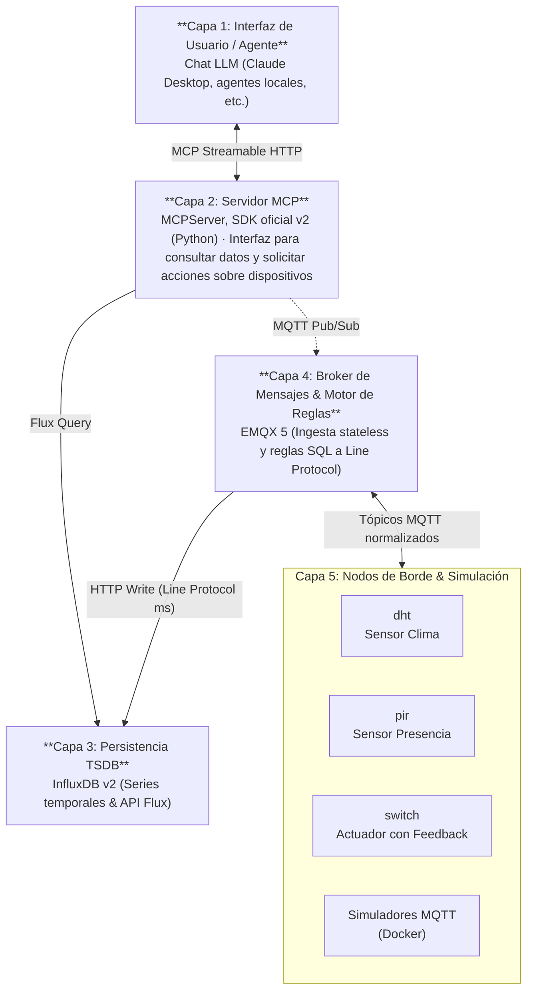

# SensorHub 🌐🤖

> **Taller de Proyecto II (2026) — Grupo G4**
> Plataforma IoT para interacción con Modelos de Lenguaje (LLM) mediante **Model Context Protocol (MCP)**.

---

## 📋 Tabla de Contenidos

- [Inicio Rápido](#-inicio-rápido)
- [Descripción del Proyecto](#-descripción-del-proyecto)
- [Arquitectura del Sistema](#-arquitectura-del-sistema)
- [Principios Rectores](#-principios-rectores-de-arquitectura)
- [Tecnologías Principales](#-tecnologías-principales)
- [Contrato de Mensajería MQTT](#-contrato-de-mensajería-mqtt)
- [Servidor MCP y LLM](#-servidor-mcp-y-llm)
- [Obtención del Proyecto](#-obtención-del-proyecto)
- [Documentación y Wiki](#-documentación-y-wiki)

---

## 🚀 Inicio Rápido

> **Requisito:** tener [Docker Desktop](https://www.docker.com/products/docker-desktop/) instalado y corriendo.

Cloná el repositorio y ejecutá el script desde la raíz del proyecto:

**Windows (PowerShell):**
```powershell
# Stack base (EMQX + InfluxDB + MCP + Inspector)
.\start.ps1

# Stack completo + simuladores de sensores
.\start.ps1 -Simuladores

# Detener todo
.\start.ps1 -Detener
```

**Linux / macOS (bash):**
```bash
# Dar permisos la primera vez
chmod +x start.sh

# Stack base
./start.sh

# Stack completo + simuladores de sensores
./start.sh --simuladores

# Detener todo
./start.sh --detener
```

Al finalizar el script, las interfaces estarán disponibles en:

| Servicio | URL | Usuario / Contraseña |
| :--- | :--- | :--- |
| EMQX Dashboard | http://localhost:18083 | `admin` / `admin` |
| InfluxDB UI | http://localhost:8086 | `admin` / `adminpassword123` |
| MCP Inspector | http://localhost:6274 | — (conectar a `http://sensorhub_mcp:8000/mcp`) |
| MCP API | http://localhost:8000/mcp | — |

---

## 📖 Descripción del Proyecto

**SensorHub** es un proyecto experimental que conecta la computación física y el Internet de las Cosas (IoT) con los Modelos de Lenguaje (LLM) y los agentes inteligentes. Los nodos IoT —basados en microcontroladores, sensores y actuadores— intercambian información mediante tópicos MQTT estandarizados. EMQX procesa los mensajes y las reglas del sistema persisten las series temporales y los eventos en InfluxDB.

El servidor **Model Context Protocol (MCP)** ofrece a los asistentes de IA una interfaz estandarizada para consultar la información de los dispositivos y, cuando corresponda, solicitar acciones sobre ellos. Así, el modelo puede interpretar solicitudes en lenguaje natural sin necesitar conocer los detalles internos de MQTT ni de la base de datos.

La arquitectura mantiene desacoplados los dispositivos, el almacenamiento y la interfaz con el LLM: los nodos siguen publicando datos aunque el servidor MCP o el modelo no estén disponibles, y la información histórica permanece en InfluxDB.

---

## 🏛️ Arquitectura del Sistema

El sistema opera bajo un esquema desacoplado de **5 capas**:



---

## 🧭 Principios Rectores de Arquitectura

El diseño del stack Firmware ↔ MQTT ↔ TSDB se rige por cuatro premisas fundamentales:

1. **Desacoplamiento total de sensores:** Los microcontroladores solo interactúan con tópicos estandarizados en el broker MQTT. Si el servidor MCP o el LLM están apagados, los sensores continúan midiendo y registrando en la base de datos sin afectación alguna.

2. **Fuente Única de Verdad (*Single Source of Truth*):** La identidad y la clase funcional de un dispositivo residen exclusivamente en la estructura del tópico MQTT (`sensorhub/<device_type>/<device_id>/<canal>`). Los cuerpos de mensaje en JSON contienen únicamente la información propia de cada sensor, sin redundar metadatos.

3. **Broker Efímero vs. Persistencia en TSDB:** El broker EMQX es 100% libre de estado (*stateless*) — puede destruirse o recrearse en frío en cualquier momento sin perder historia. Toda la persistencia de series temporales, confirmaciones de actuadores y eventos de ciclo de vida recae en **InfluxDB v2**, que sí tiene almacenamiento persistente.

4. **Escalabilidad horizontal:** La arquitectura soporta diferentes *tipos* de dispositivo, cada uno con múltiples instancias identificadas por `device_id`. La estructura de los tópicos refleja esta jerarquía y permite incorporar nuevos tipos de nodo sin modificar el stack de backend.

---

## 🛠️ Tecnologías Principales

| Componente | Tecnología | Rol en la Plataforma |
| :--- | :--- | :--- |
| **Protocolo de IA** | [Model Context Protocol (SDK oficial de Python, v2)](https://modelcontextprotocol.io/) | Servidor MCP en Python que expone herramientas de consulta y control al LLM. Transporte Streamable HTTP. |
| **Broker MQTT** | [EMQX 5](https://www.emqx.io/) | Ingesta de mensajería de alta concurrencia y motor de reglas SQL *stateless* que escribe directamente en InfluxDB. |
| **Base de Datos** | [InfluxDB v2](https://www.influxdata.com/) | Almacenamiento optimizado de métricas y eventos en series temporales con lenguaje de consulta Flux. |
| **Microcontroladores** | [ESP32 (ESP-IDF)](https://www.espressif.com/) | Nodos embebidos en C (FreeRTOS) que leen sensores (DHT, PIR) y controlan actuadores (Switch), publicando telemetría y recibiendo comandos por MQTT según el contrato de mensajería. |
| **Virtualización** | Docker & Docker Compose | Despliegue contenerizado del stack de backend (EMQX + InfluxDB) y entornos de simulación. |

### Model Context Protocol (MCP)

Estándar abierto promovido por Anthropic que define cómo los modelos de lenguaje interactúan con herramientas y datos externos. Provee tres primitivas:

- **Tools:** Funciones ejecutables invocadas por el LLM con parámetros estructurados (JSON Schema). Mecanismo principal de SensorHub.
- **Resources:** Archivos o datos de contexto leídos pasivamente por el LLM (ej. catálogo de dispositivos registrados).
- **Prompts:** Guías interactivas predefinidas para orientar al usuario.

---

## 📡 Contrato de Mensajería MQTT

### Formato de Tópico Canónico

```
sensorhub/<device_type>/<device_id>/<canal>
```

- `<device_type>`: Clase funcional (`dht`, `pir`, `switch`).
- `<device_id>`: MAC Wi-Fi del ESP32 sin separadores, en minúsculas (ej. `983dae529858`).
- `<canal>`: Tipo de mensaje: `telemetry` (datos de sensado, eventos y acuses de estado emitidos por el nodo), `command` (órdenes remotas a actuadores) y `status` (presencia y ciclo de vida vía LWT, con retención).

---

## 🤖 Servidor MCP y LLM

### SDK oficial de MCP (v2) y Arquitectura Modular (Python)

El servidor MCP está implementado en Python con la clase **`MCPServer`** del SDK oficial de MCP, versión 2 (paquete `mcp`, `from mcp.server.mcpserver import MCPServer`; en la versión 1 esa clase se llamaba `FastMCP`, y no tiene relación con el paquete independiente `fastmcp` de gofastmcp.com), expuesto mediante transporte **Streamable HTTP** en el endpoint `/mcp` (puerto por defecto `8000`). Este diseño permite la comunicación desacoplada y estandarizada con clientes LLM (como Claude Desktop, Claude Code o agentes autónomos), aislando la complejidad de los protocolos IoT (MQTT y Flux/InfluxDB).

La estructura del paquete `MCP/sensorhub_mcp/` y la función de cada módulo están en [Estructura del Repositorio](#estructura-del-repositorio) y en la [wiki 05, sección 3](https://github.com/tpII/2026-g4-sensorhub/wiki/05-Servidor-MCP-y-LLM#3-componentes-de-un-servidor-mcp-en-python-sdk-oficial-v2).

---

### Catálogo de Tools Implementadas

El catálogo de tools (preguntas en lenguaje natural, tool asociada y estrategia de fuente de datos por dispositivo) está en la [wiki 06, sección 3](https://github.com/tpII/2026-g4-sensorhub/wiki/06-Diseno-de-Tools-MCP-por-Dispositivo#3-catálogo-de-preguntas-y-tools-propuestas-por-dispositivo). La definición y el diseño de cada tool se explican en la [wiki 05, sección 3.2](https://github.com/tpII/2026-g4-sensorhub/wiki/05-Servidor-MCP-y-LLM#32-definición-de-tools-tools).

#### Roadmap de Tools por Dispositivo (según Wiki 06)

Ver el detalle en la [wiki 06, sección 3](https://github.com/tpII/2026-g4-sensorhub/wiki/06-Diseno-de-Tools-MCP-por-Dispositivo#3-catálogo-de-preguntas-y-tools-propuestas-por-dispositivo).

---

### Despliegue y Ejecución del Servidor MCP y Stack MQTT

#### 1. Prerrequisitos
El servidor MCP consulta los datos que generan el Stack y los simuladores. Antes de iniciarlo:
```bash
# 1. Levantar EMQX e InfluxDB
cd Stack && docker compose up -d

# 2. Levantar los simuladores de sensores
cd simuladores-mqtt && docker compose up -d
```

#### 2. Opciones de Ejecución

- **Opción A — Python local (recomendado para desarrollo y depuración):**
  ```bash
  cd MCP
  cp .env.example .env        # Ajustar hosts a localhost si se ejecuta fuera de Docker
  pip install -r requirements.txt
  python -m sensorhub_mcp
  ```

- **Opción B — Contenedor Docker (integrado en la red del Stack):**
  ```bash
  cd MCP
  docker compose up -d --build
  ```
  El servicio se conecta a `sensorhub_network` y resuelve `sensorhub_emqx` e `sensorhub_influxdb` automáticamente.

El servidor quedará disponible en `http://localhost:8000/mcp`.

---

### Pruebas y Validación

1. **Cliente MCP mínimo en Python:** las tools son asíncronas y reciben el contexto del servidor, así que se prueban a través del protocolo con el cliente oficial del SDK (`pip install mcp`). El ejemplo completo está en [`MCP/README.md`](MCP/README.md#1-con-un-cliente-mcp-mínimo-en-python); los errores llegan con `isError == True`.

2. **MCP Inspector (interfaz gráfica para depurar tools):**
   ```bash
   cd MCP
   docker compose up -d mcp-inspector
   ```
   Abrir `http://localhost:6274` en el navegador y conectar a `http://sensorhub_mcp:8000/mcp` (dentro de Docker) o `http://localhost:8000/mcp` (si se usa `npx @modelcontextprotocol/inspector`).

3. **Conexión a Clientes LLM Reales (Claude Desktop / Agentes):**
   Agregar el servidor MCP como endpoint remoto por URL (`http://localhost:8000/mcp`) en la configuración del cliente.

4. **Acceso Remoto desde Modelos en la Nube:**
   Para conectar modelos o servicios externos sin IP pública, se puede exponer el puerto mediante un túnel con herramientas como cloudflare tunner o ngrok para pruebas rapidas:
   ```bash
   ngrok http 8000
   ```
   Y configurar en el cliente la URL pública resultante: `https://<dominio-ngrok>.ngrok-free.app/mcp`.

---

## 🚀 Obtención del Proyecto

```bash
git clone https://github.com/tpII/2026-g4-sensorhub.git
cd 2026-g4-sensorhub
```

### Estructura del Repositorio

```
2026-g4-sensorhub/
├── Firmware/                 # Código ESP32 en C (ESP-IDF + FreeRTOS)
│   ├── sensorHub/            # Proyecto ESP-IDF del nodo SensorHub
│   │   ├── main/             # Código fuente del firmware
│   │   │   ├── main.c        # Orquestador del sistema
│   │   │   ├── app_config.h  # Configuración transversal (WiFi, MQTT, tipo de dispositivo)
│   │   │   ├── *_mgr.c/.h    # Gestores de sistema, WiFi, MQTT, hora (SNTP) y LED de estado
│   │   │   ├── sensor_service.c/.h  # Despachador según CONFIG_DEVICE_TYPE
│   │   │   └── devices/      # Módulos por tipo de dispositivo (dht, pir, switch)
│   │   ├── sdkconfig.defaults  # Opciones de Kconfig fijadas por el proyecto
│   │   └── README.md         # Guía del firmware y catálogo de variables configurables
│   └── utils/                # Docker Compose para compilar, flashear y monitorear el ESP32
├── MCP/                      # Servidor MCP (Python, SDK oficial v2)
│   ├── sensorhub_mcp/        # Paquete modular del servidor
│   │   ├── tools/            # Implementación de tools (climate, device_resolution, common)
│   │   ├── resources.py      # Resource sensorhub://device-types
│   │   ├── config.py         # Carga de variables de entorno
│   │   ├── devices.py        # Registro y matching difuso de dispositivos
│   │   ├── influx_client.py  # Consultas Flux y agregaciones a InfluxDB
│   │   ├── mqtt_client.py    # Cliente MQTT para mensajes retenidos
│   │   ├── mcp_app.py        # MCPServer: lifespan, instrucciones, transporte y seguridad HTTP
│   │   ├── timeutils.py      # Conversión de timestamps ISO 8601 a Flux
│   │   └── main.py           # Entrypoint del servidor
│   ├── devices.csv           # Registro de mapeo (living -> dht_simulado, etc.)
│   ├── docker-compose.yml    # Despliegue de mcp-server y mcp-inspector
│   ├── Dockerfile
│   ├── requirements.txt
│   └── README.md             # Guía detallada de uso del componente MCP
├── Stack/                    # Docker Compose de infraestructura
│   ├── docker-compose.yml    # EMQX 5.8 + InfluxDB 2.7
│   ├── simuladores-mqtt/     # Simuladores Python de DHT, PIR y Switch
│   └── README.md             # Guía de configuración del stack y reglas SQL
├── start.ps1                 # Script de inicio rápido para Windows (PowerShell)
├── start.sh                  # Script de inicio rápido para Linux / macOS (bash)
└── README.md                 # Documentación general del proyecto
```

---

## 📚 Documentación y Wiki

| Página | Contenido |
| :--- | :--- |
| 📘 [01. Visión y Arquitectura](https://github.com/tpII/2026-g4-sensorhub/wiki/01-Vision-y-Arquitectura) | Propósito del proyecto, principios rectores y flujos de información |
| 🔧 [02. Tecnologías y Conceptos Clave](https://github.com/tpII/2026-g4-sensorhub/wiki/02-Tecnologias-y-Conceptos-Clave) | MCP, MQTT, EMQX e InfluxDB — fundamentos y criterios de selección |
| 📡 [03. Contrato de Mensajería MQTT](https://github.com/tpII/2026-g4-sensorhub/wiki/03-Contrato-de-Mensajeria-MQTT) | Especificación de tópicos, payloads, QoS y estrategias por dispositivo |
| ⚙️ [04. Infraestructura y Pipeline EMQX-InfluxDB](https://github.com/tpII/2026-g4-sensorhub/wiki/04-Infraestructura-y-Pipeline-EMQX-InfluxDB) | Stack Docker, reglas SQL y representación dual de estados |
| 🤖 [05. Servidor MCP y LLM](https://github.com/tpII/2026-g4-sensorhub/wiki/05-Servidor-MCP-y-LLM) | SDK oficial de MCP (v2), transporte Streamable HTTP, arquitectura y diseño de tools |
| 🧭 [06. Diseño de Tools MCP por Dispositivo](https://github.com/tpII/2026-g4-sensorhub/wiki/06-Diseno-de-Tools-MCP-por-Dispositivo) | Criterios normativos, catálogo por sensor/actuador y resolución en dos pasos |
| 🔌 [07. Firmwares y Dispositivos ESP32](https://github.com/tpII/2026-g4-sensorhub/wiki/07-Firmwares-y-Dispositivos-ESP32) | Arquitectura del firmware, flujo de ejecución, dispositivos (DHT, PIR, Switch) y configuración |
| 📓 [Bitácora de Avance Semanal](https://github.com/tpII/2026-g4-sensorhub/wiki/Bitacora) | Registro cronológico del progreso del equipo |

---

> *Taller de Proyecto II — Facultad de Ingeniería — 2026*
