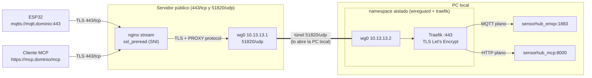

# Exposición pública por túnel WireGuard

Publica el **servidor MCP** (HTTPS) y el **broker MQTT** (MQTTS) en internet sin hostearlos en el servidor público: ese servidor solo recibe el tráfico en el 443 y lo reenvía, cifrado, por un túnel WireGuard hasta esta PC, donde corre el stack.

Se reparte en dos carpetas, una por máquina:

| Carpeta | Dónde corre | Qué levanta |
|---|---|---|
| [`../sv-publico/`](../sv-publico/) | Servidor público | Servidor WireGuard + nginx (ruteo por SNI, sin descifrar) |
| `tunel-local/` (esta) | Cada PC con servicios | Cliente WireGuard aislado + Traefik (termina TLS) |

El servidor público puede atender a varias PCs, cada una con sus dominios (ver [Agregar otra PC](#agregar-otra-pc)).

## Arquitectura



- **El TLS se termina en esta PC**, no en el servidor público: el servidor público nunca ve el tráfico descifrado ni tiene los certificados. Solo lee el SNI del `ClientHello` para decidir si lo reenvía; cualquier otro dominio se corta ahí.
- **Traefik** atiende los dos dominios en el mismo puerto: el router HTTP de `MCP_DOMAIN` descifra y reenvía a `sensorhub_mcp:8000` (solo bajo `/mcp`), y el router TCP de `MQTT_DOMAIN` descifra y le entrega MQTT plano a `sensorhub_emqx:1883`. Se eligió Traefik porque trae de fábrica el ruteo TCP por SNI, la terminación TLS y la emisión de certificados: Caddy necesita una imagen compilada con el plugin `caddy-l4` para el TCP, y nginx no gestiona certificados por su cuenta (requiere certbot y el puerto 80).
- **Certificados** por TLS-ALPN-01: Let's Encrypt valida conectándose al mismo `443` con el SNI del dominio, nginx lo reenvía por el túnel como cualquier conexión y Traefik responde el desafío. No hace falta abrir el 80 ni dar credenciales de Cloudflare.
- **IP real del cliente**: nginx la manda con PROXY protocol y Traefik solo la acepta si viene de `10.13.13.1`, así que aparece en los logs de Traefik.

### Aislamiento del contenedor del túnel

El contenedor `wireguard` no usa `network_mode: host` ni el socket de Docker: tiene su propio namespace de red, conectado solo a `sensorhub_network`, y Traefik lo comparte (`network_mode: service:wireguard`). El `entrypoint.sh` aplica un firewall en ese namespace:

| Dirección | Permitido | Bloqueado |
|---|---|---|
| Entrada por el túnel | `443/tcp` desde `10.13.13.1` (Traefik) | todo lo demás |
| Hacia `sensorhub_network` | EMQX y MCP (puertos `1883` y `8000`) | InfluxDB, dashboard de EMQX y demás |
| Hacia el host | — | gateway del bridge, toda red privada (LAN, `docker0`, etc.), IPv6 |
| Hacia internet | el túnel UDP y `443/tcp` (API de Let's Encrypt) | el resto |

Así, aunque alguien comprometiera el servidor público, por el túnel solo llega a Traefik:443.

## Puesta en marcha

### 1. Claves de WireGuard

Hace falta un par de claves por máquina. Desde cualquier máquina con Docker:

```bash
docker run --rm alpine:3.20 sh -c 'apk add -q wireguard-tools && k=$(wg genkey) && echo "privada: $k" && echo "pública: $(echo $k | wg pubkey)"'
```

Correrlo dos veces (una por máquina). Cada máquina lleva su **propia** clave privada en su `.env`. La pública del servidor va en `WG_PEER_PUBLIC_KEY` de esta PC, y la pública de esta PC va en `sv-publico/peers.conf`.

### 2. DNS en Cloudflare

Dos registros `A` hacia la IP del servidor público, con la **nube gris** (*DNS only*):

| Nombre | Tipo | Valor | Proxy |
|---|---|---|---|
| `mcp` | A | IP pública | DNS only |
| `mqtt` | A | IP pública | DNS only |

Con la nube naranja Cloudflare intenta terminar el TLS él mismo: MQTT no es HTTP y se rompe, y el desafío TLS-ALPN de Let's Encrypt no llegaría a Traefik.

### 3. Servidor público

Ver [`../sv-publico/README.md`](../sv-publico/README.md).

### 4. Esta PC

Con el stack ya levantado (la red `sensorhub_network` tiene que existir):

```bash
cd Stack/tunel-local
cp .env.example .env    # completar dominios, WG_ENDPOINT, claves y ACME_EMAIL
docker compose up -d --build
docker compose logs -f
```

En `MCP/.env`, agregar el dominio público o el servidor responde `421`/`403` (protección contra *DNS rebinding*):

```env
MCP_ALLOWED_HOSTS=localhost:*,127.0.0.1:*,sensorhub_mcp:*,mcp.ejemplo.com
MCP_ALLOWED_ORIGINS=http://localhost:*,http://127.0.0.1:*,https://mcp.ejemplo.com
```

y recrear el contenedor del MCP (`docker compose up -d` en `MCP/`).

### 5. Verificar

```bash
docker exec sensorhub_wg_local wg show          # "latest handshake" de hace segundos
docker compose ps                               # wireguard (healthy)
curl -I https://mcp.ejemplo.com/mcp             # responde el MCP (405/406 es normal sin cuerpo)
openssl s_client -connect mqtt.ejemplo.com:443 -servername mqtt.ejemplo.com </dev/null | head
```

Los certificados se piden al arrancar Traefik, así que el servidor público y el túnel tienen que estar arriba y el DNS ya apuntando a la IP pública. Si falló (se ve en `docker compose logs traefik`), Traefik reintenta solo; las renovaciones se hacen 30 días antes del vencimiento, con lo que una caída corta del túnel no llega a dejar un certificado vencido.

## Agregar otra PC

Para publicar servicios de otra PC por el mismo servidor (en el ejemplo, `pc-2` con `mcp2.ejemplo.com` y `mqtt2.ejemplo.com`):

1. En la PC nueva, copiar esta carpeta y generar un par de claves nuevo.
2. En el servidor público, agregarla a `peers.conf` con una IP libre y sus dominios a `rutas.conf` (ver [`../sv-publico/README.md`](../sv-publico/README.md#agregar-una-máquina)):

   ```text
   # peers.conf
   pc-2    <clave pública de pc-2>    10.13.13.3

   # rutas.conf
   mcp2.ejemplo.com     pc-2
   mqtt2.ejemplo.com    pc-2
   ```

3. Crear los registros `A` de `mcp2` y `mqtt2` en Cloudflare (nube gris).
4. En la PC nueva, el `.env` de `tunel-local` cambia en:

   ```env
   MCP_DOMAIN=mcp2.ejemplo.com
   MQTT_DOMAIN=mqtt2.ejemplo.com
   WG_ADDRESS=10.13.13.3
   WG_PRIVATE_KEY=<clave privada de pc-2>
   ```

   `WG_ENDPOINT`, `WG_PEER_PUBLIC_KEY` y `WG_PEER_ADDRESS` son los mismos que en esta PC: todas apuntan al mismo servidor.

[`traefik/dynamic.yml`](traefik/dynamic.yml) reenvía a `sensorhub_mcp:8000` y `sensorhub_emqx:1883`. Si la otra PC corre el mismo stack no hay que tocarlo; si corre otros servicios, ajustar ahí los destinos y `ALLOWED_PORTS` en el servicio `wireguard`.

## Cambios en los clientes

- **ESP32:** conectar a `mqtt.<dominio>` en el puerto **443** con TLS (no `8883`). El certificado es de Let's Encrypt, así que el firmware tiene que confiar en **ISRG Root X1** (o usar el bundle de CAs de ESP-IDF). El SNI tiene que ir en el `ClientHello`, lo cual pasa automáticamente al conectar por nombre (no por IP).
- **Cliente MCP:** `https://mcp.<dominio>/mcp`.

## Antes de exponerlo

Tal como está el stack, **cualquiera en internet podría usarlo**:

- **EMQX no tiene autenticación** (`no_match = allow` y sin `authentication` en [`../broker/templates/emqx.conf.template`](../broker/templates/emqx.conf.template)): cualquiera que conozca el dominio puede publicar comandos a los switches o leer la telemetría. Conviene habilitar usuario/contraseña (o certificados de cliente) en EMQX antes de levantar el túnel.
- **El MCP no tiene autenticación**: cualquiera con la URL puede invocar las tools, incluida `set_switch_state`.

## Notas

- Si el contenedor `wireguard` se reinicia, el namespace de red se recrea y Traefik queda sin red: hay que reiniciarlo también (`docker compose up -d --force-recreate traefik`).
- Traefik tiene `readTimeout=0` en el entrypoint para no cortar conexiones MQTT de larga duración; las conexiones sin tráfico durante 1 h las corta nginx en el servidor público (el keepalive MQTT de los ESP lo evita).
- Para cambiar los puertos permitidos dentro de `sensorhub_network`, definir `ALLOWED_PORTS` (por defecto `1883,8000`) en el servicio `wireguard`.
