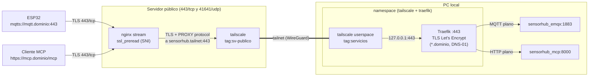

# Exposición pública por Tailscale

Publica el **servidor MCP** (HTTPS) y el **broker MQTT** (MQTTS) en internet sin hostearlos en el servidor público: ese servidor solo recibe el tráfico en el 443 y lo reenvía, cifrado, por una red privada de [Tailscale](https://tailscale.com) (*tailnet*) hasta esta PC, donde corre el stack.

Se reparte en dos carpetas, una por máquina:

| Carpeta | Dónde corre | Qué levanta |
|---|---|---|
| [`../sv-publico/`](../sv-publico/) | Servidor público | Cliente Tailscale + nginx (ruteo por SNI, sin descifrar) |
| `tunel-local/` (esta) | Cada PC con servicios | Cliente Tailscale sin privilegios + Traefik (termina TLS) |

El servidor público puede atender a varias PCs, cada una con sus dominios (ver [Agregar otra PC](#agregar-otra-pc)).

## Arquitectura



- **El TLS se termina en esta PC**, no en el servidor público: el servidor público nunca ve el tráfico descifrado ni tiene los certificados. Solo lee el SNI del `ClientHello` para decidir a qué PC reenviarlo; cualquier otro dominio se corta ahí.
- **Tailscale** arma el túnel (WireGuard por debajo) y asigna solo las IPs (`100.x.y.z`) y los nombres. nginx encuentra cada PC por su nombre en la tailnet (`sensorhub.<tailnet>.ts.net`), así que no hay IPs que administrar.
- **Traefik** atiende los dos dominios en el mismo puerto: el router HTTP de `MCP_DOMAIN` descifra y reenvía a `sensorhub_mcp:8000` (solo `/mcp`), y el router TCP de `MQTT_DOMAIN` descifra y le entrega MQTT plano a `sensorhub_emqx:1883`. Se eligió Traefik porque trae de fábrica el ruteo TCP por SNI, la terminación TLS y la emisión de certificados.
- **Certificado comodín** (`*.CERT_DOMAIN`) por desafío DNS-01: Traefik crea un registro TXT `_acme-challenge` en Cloudflare con la API, Let's Encrypt lo consulta y Traefik lo borra. Let's Encrypt no se conecta a ningún puerto, así que el certificado se obtiene y se renueva **aunque el servidor público no esté expuesto**: solo hace falta que Traefik tenga salida a internet. Un único certificado cubre los dominios (y cualquier otro subdominio directo que se agregue después).
- **IP real del cliente**: nginx la manda con PROXY protocol y Traefik solo la acepta si la conexión viene de `127.0.0.1` (desde donde la entrega Tailscale), así que aparece en los logs de Traefik.

### Quién puede llegar a qué

- **Por la tailnet** solo pasa lo que permite la [política de acceso](../sv-publico/tailscale-policy.hujson): el servidor público (`tag:sv-publico`) puede llegar al `443` de las PCs con servicios (`tag:servicios`), y nada más. Las PCs no se ven entre sí ni pueden llegar al servidor público.
- **En esta PC**, lo que entra al `443` lo recibe Traefik, que solo reenvía los dominios de [`traefik/dynamic.yml`](traefik/dynamic.yml). Un servicio que no está ahí (InfluxDB, el dashboard de EMQX) no se puede pedir desde afuera.
- **El cliente Tailscale corre en modo *userspace***: sin `NET_ADMIN` ni `/dev/net/tun`, no crea interfaces ni toca la red del host.
- **En esta máquina**, el `443` de Traefik también se publica en `TRAEFIK_LOCAL_IP`, para probar en local (ver [Probar en local](#probar-en-local)). Con `127.0.0.1` solo llega esta máquina; con `0.0.0.0`, además, cualquiera en la red local en la que esté, con la misma exposición que tendría por internet.

Lo que no cubre: si Traefik o el cliente de Tailscale tuvieran una vulnerabilidad explotable, desde ese contenedor se alcanza todo `sensorhub_network` (InfluxDB incluido), igual que desde cualquier otro contenedor del stack.

## Puesta en marcha

### 1. Tailscale

En el [panel de Tailscale](https://login.tailscale.com/admin):

1. **Access controls:** reemplazar la política por la de [`../sv-publico/tailscale-policy.hujson`](../sv-publico/tailscale-policy.hujson). Define los tags `tag:sv-publico` y `tag:servicios` y qué puede hablar con qué.
2. **DNS:** verificar que **MagicDNS** esté habilitado y anotar el *Tailnet name* (`tailXXXX.ts.net`); va en `TS_TAILNET` del servidor público.
3. **Settings → Keys → Generate auth key**, una por máquina:
   - para el servidor público, con el tag `tag:sv-publico`;
   - para cada PC con servicios, con el tag `tag:servicios`.

   Sin marcar *Reusable* ni *Ephemeral*. La key solo se usa en el primer arranque: después la identidad del nodo queda guardada en un volumen de Docker. Los dispositivos con tag no vencen, así que no hay que volver a autenticarlos.

Las auth keys son credenciales: con una, cualquiera puede sumar una máquina a la tailnet con ese tag. Van solo en el `.env` (ignorado por Git) y, una vez usadas, conviene revocarlas desde el panel.

### 2. DNS en Cloudflare

**Token de la API** (para el certificado). En Cloudflare, *My Profile → API Tokens → Create Token → Create Custom Token*:

| Campo | Valor |
|---|---|
| Permissions | `Zone` · `Zone` · `Read` y `Zone` · `DNS` · `Edit` |
| Zone Resources | `Include` · `Specific zone` · la zona del dominio (p. ej. `wgr.com.ar`) |

El token va en `CF_DNS_API_TOKEN` de `.env`. Solo puede tocar los registros DNS de esa zona, pero con él se pueden redirigir sus dominios: tratarlo como una contraseña, y si una PC deja de usarse, revocarlo desde el panel. Conviene un token por PC.

**Registro comodín** (para que lleguen los clientes). Uno solo, hacia la IP del servidor público, con la **nube gris** (*DNS only*):

| Nombre | Tipo | Valor | Proxy |
|---|---|---|---|
| `*.sensorhub` (es decir, `*.CERT_DOMAIN`) | A | IP pública | DNS only |

Cubre `mcp`, `mqtt` y cualquier dominio nuevo, así que no hay que crear un registro por servicio. Si hay registros puntuales viejos (`mcp.sensorhub`, ...) tienen prioridad sobre el comodín: borrarlos o dejarlos con la misma IP. Este registro **no hace falta para el certificado**: se puede crear recién al exponer el servidor público.

Con la nube naranja Cloudflare intenta terminar el TLS él mismo, y MQTT, que no es HTTP, se rompe.

Si la zona tiene registros `CAA`, tienen que permitir `letsencrypt.org`.

### 3. Servidor público

Ver [`../sv-publico/README.md`](../sv-publico/README.md).

### 4. SV donde corren los servicios

Con el stack ya levantado (la red `sensorhub_network` tiene que existir):

```bash
cd Stack/tunel-local
cp .env.example .env    # completar dominios (MCP, MQTT y CERT_DOMAIN), TS_AUTHKEY, TS_HOSTNAME, ACME_EMAIL y CF_DNS_API_TOKEN
docker compose up -d
docker compose logs -f
```

En `MCP/.env`, agregar el dominio público o el servidor responde `421`/`403` (protección contra *DNS rebinding*):

```env
MCP_ALLOWED_HOSTS=localhost:*,127.0.0.1:*,sensorhub_mcp:*,mcp.ejemplo.com
MCP_ALLOWED_ORIGINS=http://localhost:*,http://127.0.0.1:*,https://mcp.ejemplo.com
```

y recrear el contenedor del MCP (`docker compose up -d` en `MCP/`).

### 5. Certificado (sin exponer nada)

Se puede hacer con el servidor público apagado o sin el `443` abierto en el router.

1. **Primero contra staging**, para no gastar los límites de Let's Encrypt si algo está mal configurado: descomentar `ACME_CA_SERVER` en `.env` y `docker compose up -d`.
2. Mirar el log hasta que aparezca el certificado o un error (token sin permisos, zona equivocada...):

   ```bash
   docker compose logs -f traefik | grep -iE "acme|certif|error"
   ```

3. Confirmar qué dominios tiene guardados (sin mostrar las claves privadas de `acme.json`):

   ```bash
   docker run --rm -v sensorhub_traefik_acme:/data:ro alpine:3.20 grep -o '"main": *"[^"]*"' /data/acme.json
   # "main": "*.sensorhub.wgr.com.ar"
   ```

4. Ver el certificado que entrega Traefik, conectándose desde su propio namespace de red:

   ```bash
   docker run --rm --network container:sensorhub_ts_local alpine:3.20 sh -c \
     'apk add -q openssl && openssl s_client -connect 127.0.0.1:443 -servername mcp.sensorhub.wgr.com.ar </dev/null 2>/dev/null | openssl x509 -noout -subject -issuer -dates'
   ```

   Con staging, el emisor es `(STAGING) ...`.
5. **Pasar a producción:** comentar `ACME_CA_SERVER`, borrar el certificado de staging y reiniciar Traefik:

   ```bash
   docker run --rm -v sensorhub_traefik_acme:/data alpine:3.20 rm /data/acme.json
   docker compose up -d --force-recreate traefik
   ```

   Repetir los pasos 2 a 4: el emisor tiene que ser `Let's Encrypt`.

Las renovaciones también son por DNS: Traefik las hace solo 30 días antes del vencimiento, esté o no expuesto el servidor público.

### 6. Verificar de punta a punta

```bash
docker exec sensorhub_ts_local tailscale status   # aparecen sensorhub y toshi
docker compose ps                                 # tailscale (healthy)
curl -i https://mcp.ejemplo.com/mcp               # responde el MCP (401 sin token)
openssl s_client -connect mqtt.ejemplo.com:443 -servername mqtt.ejemplo.com </dev/null | head
```

Esto ya necesita el servidor público y la tailnet arriba y el registro comodín apuntando a la IP pública. Para probar antes de abrir el `443` del router, ver [Probar en local](#probar-en-local).

### Probar en local

Con el certificado ya emitido, se puede probar todo con los dominios reales y HTTPS sin exponer nada a internet, apuntando los dominios en el `/etc/hosts` de la PC. Cada nombre apunta a una sola IP, así que se elige un camino:

```text
# A) Directo al Traefik de esta máquina (prueba Traefik, MCP y EMQX)
127.0.0.1      mcp.sensorhub.wgr.com.ar mqtt.sensorhub.wgr.com.ar
# B) Por el servidor público en la red local (prueba además nginx y la tailnet)
#192.168.0.33  mcp.sensorhub.wgr.com.ar mqtt.sensorhub.wgr.com.ar
```

- **A** usa el `443` publicado en `TRAEFIK_LOCAL_IP` y no necesita ni el servidor público ni la tailnet.
- **B** recorre el mismo camino que desde internet, con el router todavía cerrado.
- Otros equipos de la red local (un celular, un ESP32) no tienen `/etc/hosts`: necesitan un DNS local (el del router, Pi-hole...) que resuelva los dominios a la IP de esta PC (con `TRAEFIK_LOCAL_IP=0.0.0.0`) o a la del servidor público.

En los dos caminos Traefik ve como origen la puerta de enlace de Docker o el nginx, no la IP real del cliente, así que en sus logs todas las conexiones locales aparecen igual.

## Agregar otra PC

Para publicar servicios de otra PC por el mismo servidor (en el ejemplo, `pc-2` con `mcp2.ejemplo.com` y `mqtt2.ejemplo.com`; tienen que ser subdominios directos de `CERT_DOMAIN`, para que los cubra el comodín):

1. Generar una auth key con `tag:servicios`.
2. En la PC nueva, copiar esta carpeta. Su `.env` cambia en:

   ```env
   MCP_DOMAIN=mcp2.ejemplo.com
   MQTT_DOMAIN=mqtt2.ejemplo.com
   TS_AUTHKEY=<auth key nueva>
   TS_HOSTNAME=pc-2
   CF_DNS_API_TOKEN=<token de Cloudflare para esta PC>
   ```

   Cada PC pide su propia copia del comodín. Let's Encrypt permite 5 certificados por semana con exactamente los mismos dominios, así que no conviene borrar `acme.json` seguido.

3. En el servidor público, agregar sus dominios a `rutas.conf` y reiniciar nginx (ver [`../sv-publico/README.md`](../sv-publico/README.md#agregar-una-máquina)):

   ```text
   mcp2.ejemplo.com     pc-2
   mqtt2.ejemplo.com    pc-2
   ```

4. En Cloudflare no hay que crear nada: el registro comodín ya cubre los dominios nuevos.

No hay IPs ni claves que copiar entre máquinas: Tailscale asigna la IP y nginx encuentra la PC por su `TS_HOSTNAME`.

[`traefik/dynamic.yml`](traefik/dynamic.yml) reenvía a `sensorhub_mcp:8000` y `sensorhub_emqx:1883`. Si la otra PC corre el mismo stack no hay que tocarlo; si corre otros servicios, ajustar ahí los destinos.

## Cambios en los clientes

- **ESP32:** conectar a `mqtt.<dominio>` en el puerto **443** con TLS (no `8883`). El certificado es de Let's Encrypt, así que el firmware tiene que confiar en **ISRG Root X1** (o usar el bundle de CAs de ESP-IDF). El SNI tiene que ir en el `ClientHello`, lo cual pasa automáticamente al conectar por nombre (no por IP).
- **Cliente MCP:** `https://mcp.<dominio>/mcp`.

## Antes de exponerlo

El MCP exige un token fijo (`MCP_AUTH_TOKEN`) y EMQX exige usuario y contraseña, así que la URL o el dominio solos no alcanzan. Lo que queda por tener en cuenta:

- **MQTT con un usuario compartido**: todos los dispositivos (ESP32 y simuladores) usan el mismo usuario, y la autorización deja pasar lo que no cubre la ACL (`no_match = allow` en [`../broker/templates/emqx.conf.template`](../broker/templates/emqx.conf.template)). Quien saque esa contraseña de un ESP32 puede publicar comandos a todos los switches. Si se compromete un dispositivo, hay que cambiarla en todos.
- **Token del MCP compartido**: es un único secreto, sin usuarios ni vencimiento; quien lo tenga puede invocar todas las tools (incluida `set_switch_state`). Se guarda solo en el `.env` del MCP y en la configuración del conector; para rotarlo se cambia `MCP_AUTH_TOKEN` en `MCP/.env`, se recrea el contenedor y se actualiza el conector.
- **`TRAEFIK_LOCAL_IP=0.0.0.0`** deja a Traefik alcanzable desde la red local en la que esté la PC, sin pasar por el servidor público: en una red que no es de confianza (un wifi público), volver a `127.0.0.1`.

## Notas

- Si el contenedor `tailscale` se recrea, el namespace de red cambia y Traefik queda sin red: hay que recrearlo también (`docker compose up -d --force-recreate traefik`).
- Si se borra el volumen `sensorhub_ts_local_state`, la PC aparece como una máquina nueva: hace falta una auth key nueva y borrar la vieja del panel (si no, la nueva queda como `sensorhub-1` y nginx no la encuentra).
- Traefik tiene `readTimeout=0` en el entrypoint para no cortar conexiones MQTT de larga duración; las conexiones sin tráfico durante 1 h las corta nginx en el servidor público (el keepalive MQTT de los ESP lo evita).
