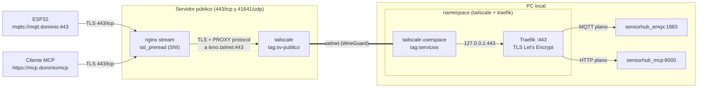

# Exposición pública por Tailscale

Publica el **servidor MCP** (HTTPS) y el **broker MQTT** (MQTTS) en internet sin hostearlos en el servidor público: ese servidor solo recibe el tráfico en el 443 y lo reenvía, cifrado, por una red privada de [Tailscale](https://tailscale.com) (*tailnet*) hasta esta PC, donde corre el stack.

Se reparte en dos carpetas, una por máquina:

| Carpeta | Dónde corre | Qué levanta |
|---|---|---|
| [`../sv-publico/`](../sv-publico/) | Servidor público | Cliente Tailscale + nginx (ruteo por SNI, sin descifrar) |
| `tunel-local/` (esta) | Cada PC con servicios | Cliente Tailscale sin privilegios + Traefik (termina TLS) |

El servidor público puede atender a varias PCs, cada una con sus dominios (ver [Agregar otra PC](#agregar-otra-pc)).

## Arquitectura



- **El TLS se termina en esta PC**, no en el servidor público: el servidor público nunca ve el tráfico descifrado ni tiene los certificados. Solo lee el SNI del `ClientHello` para decidir a qué PC reenviarlo; cualquier otro dominio se corta ahí.
- **Tailscale** arma el túnel (WireGuard por debajo) y asigna solo las IPs (`100.x.y.z`) y los nombres. nginx encuentra cada PC por su nombre en la tailnet (`leno.<tailnet>.ts.net`), así que no hay IPs que administrar.
- **Traefik** atiende los dos dominios en el mismo puerto: el router HTTP de `MCP_DOMAIN` descifra y reenvía a `sensorhub_mcp:8000` (solo bajo `/mcp`), y el router TCP de `MQTT_DOMAIN` descifra y le entrega MQTT plano a `sensorhub_emqx:1883`. Se eligió Traefik porque trae de fábrica el ruteo TCP por SNI, la terminación TLS y la emisión de certificados.
- **Certificados** por TLS-ALPN-01: Let's Encrypt valida conectándose al mismo `443` con el SNI del dominio, nginx lo reenvía como cualquier conexión y Traefik responde el desafío. No hace falta abrir el 80.
- **IP real del cliente**: nginx la manda con PROXY protocol y Traefik solo la acepta si la conexión viene de `127.0.0.1` (desde donde la entrega Tailscale), así que aparece en los logs de Traefik.

### Quién puede llegar a qué

- **Por la tailnet** solo pasa lo que permite la [política de acceso](../sv-publico/tailscale-policy.hujson): el servidor público (`tag:sv-publico`) puede llegar al `443` de las PCs con servicios (`tag:servicios`), y nada más. Las PCs no se ven entre sí ni pueden llegar al servidor público.
- **En esta PC**, lo que entra al `443` lo recibe Traefik, que solo reenvía los dominios de [`traefik/dynamic.yml`](traefik/dynamic.yml). Un servicio que no está ahí (InfluxDB, el dashboard de EMQX) no se puede pedir desde afuera.
- **El cliente Tailscale corre en modo *userspace***: sin `NET_ADMIN` ni `/dev/net/tun`, no crea interfaces ni toca la red del host. Tampoco publica puertos en el host.

Lo que no cubre: si Traefik o el cliente de Tailscale tuvieran una vulnerabilidad explotable, desde ese contenedor se alcanza todo `sensorhub_network` (InfluxDB incluido), igual que desde cualquier otro contenedor del stack.

## Puesta en marcha

### 1. Tailscale

En el [panel de Tailscale](https://login.tailscale.com/admin):

1. **Access controls:** reemplazar la política por la de [`../sv-publico/tailscale-policy.hujson`](../sv-publico/tailscale-policy.hujson). Define los tags `tag:sv-publico` y `tag:servicios` y qué puede hablar con qué.
2. **DNS:** verificar que **MagicDNS** esté habilitado y anotar el *Tailnet name* (`tailXXXX.ts.net`); va en `TS_TAILNET` del servidor público.
3. **Settings → Keys → Generate auth key**, una por máquina:
   - para el servidor público, con el tag `tag:sv-publico`;
   - para cada PC con servicios, con el tag `tag:servicios`.

   Sin marcar *Reusable* ni *Ephemeral*. La key solo se usa en el primer arranque: después la identidad del nodo queda guardada en un volumen de Docker. Los dispositivos con tag no vencen, así que no hay que volver a autenticarlos.

Las auth keys son credenciales: con una, cualquiera puede sumar una máquina a la tailnet con ese tag. Van solo en el `.env` (ignorado por Git) y, una vez usadas, conviene revocarlas desde el panel.

### 2. DNS en Cloudflare

Dos registros `A` hacia la IP del servidor público, con la **nube gris** (*DNS only*):

| Nombre | Tipo | Valor | Proxy |
|---|---|---|---|
| `mcp` | A | IP pública | DNS only |
| `mqtt` | A | IP pública | DNS only |

Con la nube naranja Cloudflare intenta terminar el TLS él mismo: MQTT no es HTTP y se rompe, y el desafío TLS-ALPN de Let's Encrypt no llegaría a Traefik.

### 3. Servidor público

Ver [`../sv-publico/README.md`](../sv-publico/README.md).

### 4. SV donde corren los servicios

Con el stack ya levantado (la red `sensorhub_network` tiene que existir):

```bash
cd Stack/tunel-local
cp .env.example .env    # completar dominios, TS_AUTHKEY, TS_HOSTNAME y ACME_EMAIL
docker compose up -d
docker compose logs -f
```

En `MCP/.env`, agregar el dominio público o el servidor responde `421`/`403` (protección contra *DNS rebinding*):

```env
MCP_ALLOWED_HOSTS=localhost:*,127.0.0.1:*,sensorhub_mcp:*,mcp.ejemplo.com
MCP_ALLOWED_ORIGINS=http://localhost:*,http://127.0.0.1:*,https://mcp.ejemplo.com
```

y recrear el contenedor del MCP (`docker compose up -d` en `MCP/`).

### 5. Verificar

```bash
docker exec sensorhub_ts_local tailscale status   # aparecen leno y toshi
docker compose ps                                 # tailscale (healthy)
curl -I https://mcp.ejemplo.com/mcp               # responde el MCP (405/406 es normal sin cuerpo)
openssl s_client -connect mqtt.ejemplo.com:443 -servername mqtt.ejemplo.com </dev/null | head
```

Los certificados se piden al arrancar Traefik, así que el servidor público y la tailnet tienen que estar arriba y el DNS ya apuntando a la IP pública. Si falló (se ve en `docker compose logs traefik`), Traefik reintenta solo; las renovaciones se hacen 30 días antes del vencimiento, con lo que una caída corta no llega a dejar un certificado vencido.

## Agregar otra PC

Para publicar servicios de otra PC por el mismo servidor (en el ejemplo, `pc-2` con `mcp2.ejemplo.com` y `mqtt2.ejemplo.com`):

1. Generar una auth key con `tag:servicios`.
2. En la PC nueva, copiar esta carpeta. Su `.env` cambia en:

   ```env
   MCP_DOMAIN=mcp2.ejemplo.com
   MQTT_DOMAIN=mqtt2.ejemplo.com
   TS_AUTHKEY=<auth key nueva>
   TS_HOSTNAME=pc-2
   ```

3. En el servidor público, agregar sus dominios a `rutas.conf` y reiniciar nginx (ver [`../sv-publico/README.md`](../sv-publico/README.md#agregar-una-máquina)):

   ```text
   mcp2.ejemplo.com     pc-2
   mqtt2.ejemplo.com    pc-2
   ```

4. Crear los registros `A` de `mcp2` y `mqtt2` en Cloudflare (nube gris).

No hay IPs ni claves que copiar entre máquinas: Tailscale asigna la IP y nginx encuentra la PC por su `TS_HOSTNAME`.

[`traefik/dynamic.yml`](traefik/dynamic.yml) reenvía a `sensorhub_mcp:8000` y `sensorhub_emqx:1883`. Si la otra PC corre el mismo stack no hay que tocarlo; si corre otros servicios, ajustar ahí los destinos.

## Cambios en los clientes

- **ESP32:** conectar a `mqtt.<dominio>` en el puerto **443** con TLS (no `8883`). El certificado es de Let's Encrypt, así que el firmware tiene que confiar en **ISRG Root X1** (o usar el bundle de CAs de ESP-IDF). El SNI tiene que ir en el `ClientHello`, lo cual pasa automáticamente al conectar por nombre (no por IP).
- **Cliente MCP:** `https://mcp.<dominio>/mcp`.

## Antes de exponerlo

Tal como está el stack, **cualquiera en internet podría usarlo**:

- **EMQX no tiene autenticación** (`no_match = allow` y sin `authentication` en [`../broker/templates/emqx.conf.template`](../broker/templates/emqx.conf.template)): cualquiera que conozca el dominio puede publicar comandos a los switches o leer la telemetría. Conviene habilitar usuario/contraseña (o certificados de cliente) en EMQX antes de levantar el túnel.
- **El MCP no tiene autenticación**: cualquiera con la URL puede invocar las tools, incluida `set_switch_state`.

## Notas

- Si el contenedor `tailscale` se recrea, el namespace de red cambia y Traefik queda sin red: hay que recrearlo también (`docker compose up -d --force-recreate traefik`).
- Si se borra el volumen `sensorhub_ts_local_state`, la PC aparece como una máquina nueva: hace falta una auth key nueva y borrar la vieja del panel (si no, la nueva queda como `leno-1` y nginx no la encuentra).
- Traefik tiene `readTimeout=0` en el entrypoint para no cortar conexiones MQTT de larga duración; las conexiones sin tráfico durante 1 h las corta nginx en el servidor público (el keepalive MQTT de los ESP lo evita).
